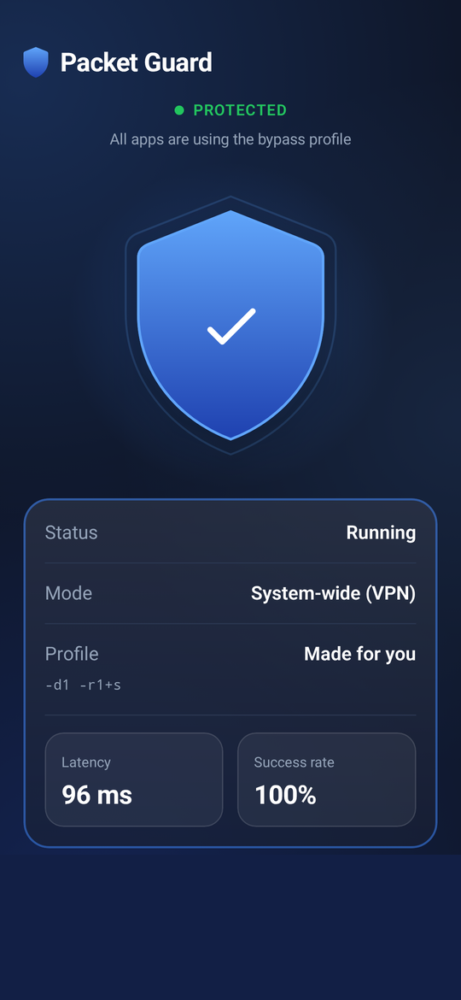
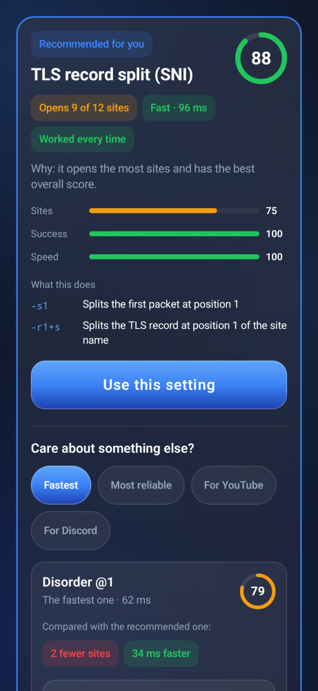
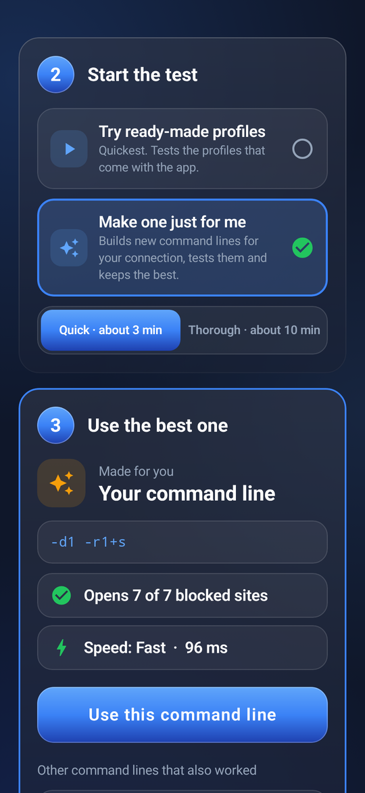
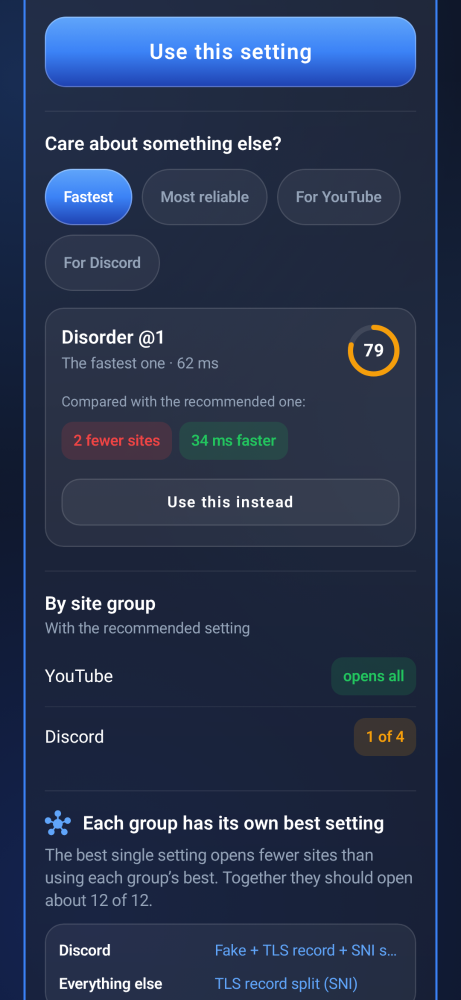
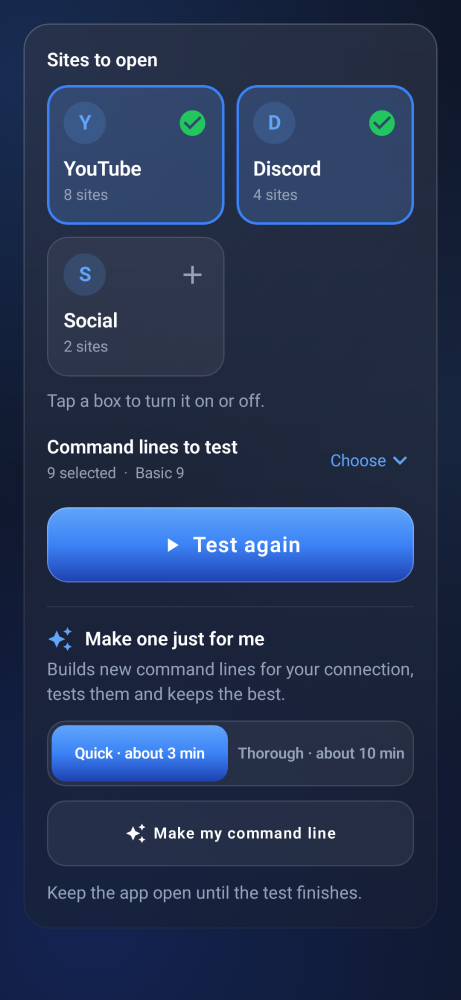
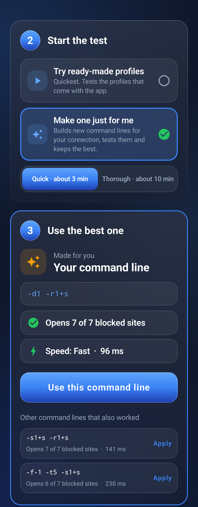
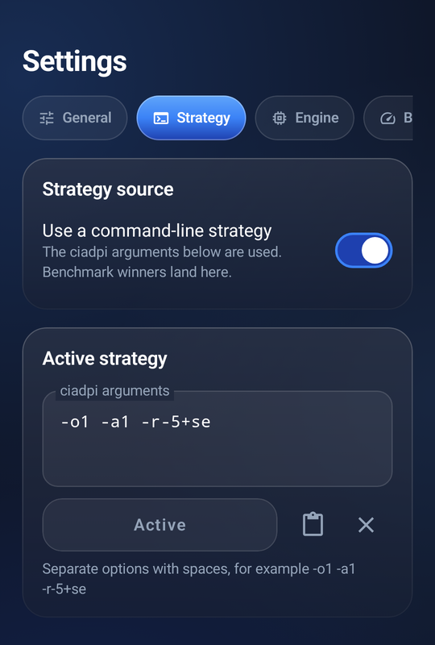

<p align="center">
  
</p>

<h1 align="center">Packet Guard</h1>

<p align="center">
  <b>Open blocked sites on Android, with no VPN server and no account.</b><br>
  Packet Guard runs a DPI-bypass engine on your phone, finds the setting that works on your network, and keeps it on.
</p>

<p align="center">
  <a href="https://github.com/S1rHades/Packet-Gaurd-1.0/releases/latest/download/PacketGuard.apk"></a>
  &nbsp;
  <a href="CHANGELOG.md"></a>
</p>

<p align="center">
  
  &nbsp;
  
  &nbsp;
  
</p>

## Highlights

- **One tap to protect.** Tap the shield and every app goes through the bypass, or only the apps you choose.
- **Finds what works for you.** The Benchmark scores every setting out of 100 on sites opened, success and speed, recommends one, and shows what you'd gain or give up with the fastest or most reliable instead.
- **Or makes one just for you.** The command line generator builds and tests new settings for your own connection, round by round, and keeps the best.
- **Easy for anyone.** Big buttons, the answer first, and plain sentences like "Opens 11 of 12 sites" and "22 ms faster".
- **Updates itself.** A banner appears when a new version is out; one tap downloads it and Android installs it over the old one, keeping your settings.
- **Nothing in between.** There is no remote server: your traffic goes straight to the sites you visit. No accounts, no ads, no tracking.
- **In your language.** English, Russian, Turkish, Kazakh and Vietnamese.

## A tour

### Connect

Tap the shield to turn protection on or off. The card below says whether it's running, the mode (the whole phone through Android's VPN, or a local proxy for chosen apps), which profile is in use, and a live latency and success rate, checked every 20 seconds while you're connected. Pull down to check again straight away.

It can also connect by itself when the app opens or when the phone starts (**Settings → General → Behavior**), and from the quick-settings tile or a home-screen shortcut.

### Benchmark: find the best setting

The page has two cards. The answer comes first; under it is the test.

<table>
  <tr>
    <td width="33%"><br><sub><b>Recommended for you</b>: one setting, its score and why.</sub></td>
    <td width="33%"><br><sub>In the same card: <b>other goals</b>, <b>site groups</b> and one line for all groups.</sub></td>
    <td width="33%"><br><sub><b>The test</b>: sites, command lines, Test, and the generator under it.</sub></td>
  </tr>
</table>

**Recommended for you** holds everything about the answer:

- **A score for every command line**, out of 100: sites opened count for half, how often it worked for 30% and speed for 20%. Bars show the three parts, so the number always makes sense.
- **The recommendation**: the best score among the settings nothing else beats, with the reason in one sentence ("it's the only one that opens every site") and one button.
- **Care about something else?** **Fastest**, **Most reliable** and **For YouTube** (or any list) each show the setting for that goal and what you'd gain or give up compared with the recommended one, such as "22 ms faster" in green and "1 fewer site" in red. If the recommended one is already the best for that goal, it says so.
- **By site group** shows how the recommended setting does on each list.
- **Use the best for each group**: when two lists each prefer a different setting, one tap builds a command line that uses each where it works best.

**The test card** holds everything about testing: the site lists as big tiles (YouTube, Discord, social networks, news and more), **Command lines to test** (9 basic ones, 60 from the ByeByeDPI community and your own; tap **Choose** to pick), and the **Test** button. A large percentage, "Trying profile 4 of 8" and the minutes left show how far it has got; protection pauses while it runs. Under it, in the same card, is **Make one just for me** (below). **All results** lists every setting by score, and **Advanced options** holds editing the site lists and the best setting for each single site.

### Make one just for me



Under the **Test** button, choose **Quick** (about 3 minutes) or **Thorough** (about 10) and tap **Make my command line**. Packet Guard then writes its own command line, and explains each part of it in plain words:

1. **Which sites are blocked?** It checks your sites with no bypass at all, and only searches for the ones your provider actually blocks. If none are blocked, it says so.
2. **What this phone already knows.** Every command line tested here before (in any Benchmark, including the 60 community lines, and in earlier searches) is remembered site by site. The search starts from that: those results already count towards what works, and the three best earlier lines for your blocked sites are tested again in the first round, exactly as written. Newer results count more; a result loses half its weight every two weeks.
3. **Probes.** Alongside them it sends one of each basic technique (splitting the first packet, sending parts out of order, out-of-band bytes, a fake packet, splitting the TLS record). These are experiments, not answers: they show which techniques get which of your sites through.
4. **Learning.** Every result is recorded site by site, and each ingredient of a command line (the technique, where it splits, the fake's TTL, the TLS record split) gets credit for the sites it opened.
5. **Building new lines.** Each round it writes new command lines from what it learned:
   - **targeted**: adds to the best line the ingredient most likely to open the sites it still misses, including ideas not tried yet, like a TTL range no probe used;
   - **combined**: merges two lines that open different sites into one, or the two or three lines that between them open the most sites, so lines that each get a different site through (for example two community lines) become one;
   - **fallback**: gives the best line a second setting that ciadpi switches to when a site looks blocked (`-At,s`);
   - **tuned and explored**: new positions, techniques and TTLs, chosen by what worked, plus one line drawn from the learning alone.
6. **Re-test.** The top three are tested again so a lucky moment can't win.

The result says whether it is a **new** line and how it was made ("Combines two lines that opened different sites: -d1+s + -f-1 -t4"). If a basic probe or a line you'd tested before still turns out best, it says that too, with how many new lines it tried. When it builds a better line it shows both scores ("Scores 92. The best line tested before on your phone scored 61 on these sites"), and it says how many earlier lines it learned from. Since the best earlier lines are tested again in the same search, its answer can't score lower than them on your blocked sites. The memory stays on the phone and is cleared by **Reset settings**.

The result fits the network you ran it on. If you switch between Wi-Fi and mobile data, or sites stop opening, run it again.

<br clear="right">

### Settings



Four tabs:

- **General**: the connection mode, connecting on open or at start-up, DNS, IPv6, which apps use the bypass, and battery and always-on VPN shortcuts. **Show advanced settings** at the bottom adds the local proxy's address, engine limits and test timing.
- **Strategy**: **Type it** (the command line in use, explained line by line in plain words, and every strategy you've saved, with its last test result) or **Use switches** (the same options as switches and fields).
- **Benchmark**: your own profiles, and with advanced settings on, requests per site and timeouts.
- **About**: updates, backup and restore, a diagnostic report to paste into a bug report, and credits.

<br clear="right">

### Updates

Packet Guard looks for a new version a few seconds after it opens and every 6 hours while it stays open. When there is one, a banner on the Connect screen says so, with what's new; **Update** downloads it and Android asks you to confirm the install. **Settings → About → Updates** shows your version, a **Check for updates** button and a switch to stop the automatic checks. The first time, Android asks you to allow Packet Guard to install apps.

### Notifications

The notifications use the app's look and words. While protected: "Protected", where your traffic goes, the setting in use, how long it has been on, and **Pause** and **Disconnect**. During a Benchmark or a search: a progress bar with the percentage, the round, and **Stop**. On Android 16 and later they appear as Live Updates, with a chip in the status bar; this can be turned off for Packet Guard in the system's notification settings.

## Install

1. On your phone, tap **Download Packet Guard** above (or open the [latest release](https://github.com/S1rHades/Packet-Gaurd-1.0/releases/latest) and choose `PacketGuard.apk`).
2. Open the file. If Android asks, allow your browser to install apps, then choose **Install**.
3. Open Packet Guard and tap the shield. Android asks once whether Packet Guard may set up a VPN: choose **OK**.

It works on Android 5 and later. `PacketGuard.apk` runs on every phone; each release also has smaller builds for one processor type (`arm64-v8a` fits almost every recent phone).

**Coming from a build older than 2.1.0?** Those were signed with a temporary key, so Android won't install over them. Export your settings first (**Settings → About → Export settings**), uninstall the old copy, install the new one, then import them.

### When a site still won't open

1. Run the **Benchmark** with that site's list switched on, or add the site under **Advanced options → Edit site lists**.
2. If no ready-made profile works, try **Make one just for me**, ideally **Thorough**.
3. If even that opens nothing, your provider may block the site by its address rather than by inspecting traffic, which Packet Guard can't get around.

Reports are welcome as [issues](https://github.com/S1rHades/Packet-Gaurd-1.0/issues); paste the diagnostic report from **Settings → About**.

## Privacy

Packet Guard has no server of its own and collects nothing. It connects to:

- the sites you open, directly, through the bypass on your phone;
- your DNS server, to look up sites' addresses in VPN mode (1.1.1.1 unless you pick another under **Settings → General**);
- the sites in your switched-on lists, during a Benchmark and for the Connect screen's latency check (up to three of them every 20 seconds while connected);
- GitHub, to check for updates (switch off under **Settings → About → Updates**).

The full [privacy policy](PRIVACY.md) also covers what's stored on the phone and why each permission is needed.

## Development

```
ByeDPI-Guard/app/src/main/
├── cpp/byedpi, jni/hev-socks5-tunnel   the native engine (ByeDPI) and VPN tunnel
└── java/io/github/romanvht/byedpi/
    ├── core/, services/      native bridges, VPN/proxy services, TestService (from ByeByeDPI)
    ├── data/, utility/       settings, lists, history, site checks, backups
    ├── update/               in-app updates from GitHub releases
    └── ui/                   the Jetpack Compose interface
        ├── Glass, Theme, Motion, Components   design system
        ├── ConnectScreen, ShieldButton        Connect
        ├── BenchmarkScreen, BenchModel        Benchmark steps and ranking
        ├── BenchDecision, BenchResults        scores, the recommendation and choices by goal
        ├── CommandSearch, CommandGenerator    the command line generator
        └── Settings*, UpdateUi                Settings tabs and updates
```

The Kotlin package stays `io.github.romanvht.byedpi` because the native JNI symbols are bound to it; the app ID is `com.packetguard.app`.

**Building.** Open `ByeDPI-Guard` in Android Studio, or run `./gradlew testDebugUnitTest lintDebug assembleDebug` there. It needs JDK 17, Android SDK 36, NDK 27.0.12077973 and CMake 3.22.1.

**Text.** The interface's text is in `res/values*/strings_ui.xml` (keys start with `pg_`). English is the default; add each new key to every language.

**Usability.** Changes to the interface follow 20 UX laws; [docs/usability-test.md](docs/usability-test.md) is a 15-minute test to run with five people after each release.

**Releases.** [`.github/workflows/build-apk.yml`](.github/workflows/build-apk.yml) runs the tests and lint on every push and pull request and keeps the APKs as a build artifact. On `main`, a new `versionName` in `app/build.gradle.kts` publishes a signed release, tagged `v<version>`, with `PacketGuard.apk`, `PacketGuard-v<version>-universal.apk` and per-processor builds. Its description is that version's section of [CHANGELOG.md](CHANGELOG.md), and the app shows the first bullet points as "What's new".

**Signing.** Release APKs are signed with a key stored in four repository secrets: `KEYSTORE_BASE64` (the keystore, `base64 -w0 release.jks`), `KEYSTORE_PASSWORD`, `KEY_ALIAS` and `KEY_PASSWORD`. Without them the workflow builds debug APKs and publishes nothing. Keep a backup of the keystore: without the same key, users would have to uninstall to update. To sign locally, set `PG_KEYSTORE_FILE`, `PG_KEYSTORE_PASSWORD`, `PG_KEY_ALIAS` and `PG_KEY_PASSWORD` and run `./gradlew assembleRelease`.

**Roadmap.** Planned features and known issues are in [ROADMAP.md](ROADMAP.md).

The screenshots above were rendered from the app's own Compose code with sample results.

## Credits and license

Packet Guard is built on [ByeByeDPI for Android](https://github.com/romanvht/ByeDPIAndroid) by romanvht and the [ByeDPI](https://github.com/hufrea/byedpi) engine by hufrea, both GPL-3.0, with [hev-socks5-tunnel](https://github.com/heiher/hev-socks5-tunnel) by heiher (MIT). The community profiles come from ByeByeDPI.

Packet Guard is licensed under the [GNU General Public License v3.0](ByeDPI-Guard/LICENSE).
