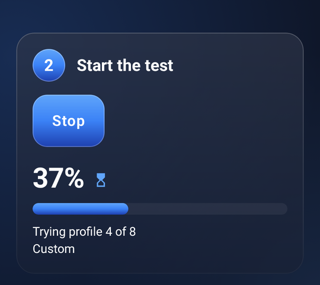

<p align="center">
  
</p>

<h1 align="center">Packet Guard</h1>

<p align="center">
  <b>Open blocked sites on Android, with no VPN server and no account.</b><br>
  Packet Guard runs a DPI-bypass engine on your phone, finds the setting that works on your network, and keeps it on.
</p>

<p align="center">
  <a href="https://github.com/S1rHades/Packet-Gaurd-1.0/releases/latest/download/PacketGuard.apk"></a>
  &nbsp;
  <a href="CHANGELOG.md"></a>
</p>

<p align="center">
  
  &nbsp;
  
  &nbsp;
  
</p>

## Highlights

- **One tap to protect.** Tap the shield and every app goes through the bypass, or only the apps you choose.
- **Finds what works for you.** The Benchmark tries ready-made profiles against the sites you care about and tells you, in plain words, which one opens the most, the fastest.
- **Or makes one just for you.** The command line generator builds and tests new settings for your own connection, round by round, and keeps the best.
- **Easy for anyone.** Big buttons, three numbered steps, and plain sentences like "Opens 11 of 12 sites" and "Speed: Fast".
- **Updates itself.** A banner appears when a new version is out; one tap downloads it and Android installs it over the old one, keeping your settings.
- **Nothing in between.** There is no remote server: your traffic goes straight to the sites you visit. No accounts, no ads, no tracking.
- **In your language.** English, Russian, Turkish, Kazakh and Vietnamese.

## A tour

### Connect

Tap the shield to turn protection on or off. The card below says whether it's running, the mode (the whole phone through Android's VPN, or a local proxy for chosen apps), which profile is in use, and a live latency and success rate, checked every 20 seconds while you're connected. Pull down to check again straight away.

It can also connect by itself when the app opens or when the phone starts (**Settings → General → Behavior**), and from the quick-settings tile or a home-screen shortcut.

### Benchmark: find the best setting

The Benchmark is three steps, top to bottom.

1. **Pick what you want to open.** Each site list (YouTube, Discord, social networks, news and more) is a big tile: tap it to switch it on or off.
2. **Start the test.** One big button. A large percentage and "Trying profile 4 of 8" show how far it has got; protection pauses while it runs.
3. **Use the best one.** The winner, with how many sites it opens and how fast, and one big button to use it.

<table>
  <tr>
    <td width="50%"><br><sub><b>While it tests</b>: how far it has got, in big numbers.</sub></td>
    <td width="50%"><br><sub><b>Results dashboard</b>: every profile and list compared.</sub></td>
  </tr>
</table>

Below the steps, the **results dashboard** compares every profile tested: the fastest one, how many sites opened, the most reliable one, and a chart of the best eight by latency, reach or success rate. Tap a bar to see that profile and use it. **Link list performance** shows how much of each list opened, its average latency and the profile that suits it best.

**Advanced options**, closed at first, holds the rest: which profiles to test (9 basic ones, 60 from the ByeByeDPI community, and your own), editing the site lists, and the best profile for each single site.

### Make one just for me


In step 2, choose **Make one just for me** instead of the ready-made profiles, then **Quick** (about 3 minutes) or **Thorough** (about 10). Packet Guard then writes its own command line, and explains each part of it in plain words:

1. It checks your sites with no bypass at all, and only searches for the ones your provider actually blocks. If none are blocked, it says so.
2. It tries each basic technique: splitting the first packet, sending parts out of order, out-of-band bytes, a fake packet with a short TTL, and splitting the TLS record, at the positions that usually matter.
3. It varies the best three, round by round: other positions, another technique, a different fake TTL, adding or removing a second step.
4. It tests the top three again so a lucky moment can't win, and shows the best with two runner-ups, each one tap to use.

The result fits the network you ran it on. If you switch between Wi-Fi and mobile data, or sites stop opening, run it again.

<br clear="right">

### Settings


Four tabs:

- **General**: the connection mode, connecting on open or at start-up, DNS, IPv6, which apps use the bypass, and battery and always-on VPN shortcuts. **Show advanced settings** at the bottom adds the local proxy's address, engine limits and test timing.
- **Strategy**: **Type it** (the command line in use, explained line by line in plain words, and every strategy you've saved, with its last test result) or **Use switches** (the same options as switches and fields).
- **Benchmark**: your own profiles, and with advanced settings on, requests per site and timeouts.
- **About**: updates, backup and restore, a diagnostic report to paste into a bug report, and credits.

<br clear="right">

### Updates

Packet Guard looks for a new version a few seconds after it opens and every 6 hours while it stays open. When there is one, a banner on the Connect screen says so, with what's new; **Update** downloads it and Android asks you to confirm the install. **Settings → About → Updates** shows your version, a **Check for updates** button and a switch to stop the automatic checks. The first time, Android asks you to allow Packet Guard to install apps.

## Install

1. On your phone, tap **Download Packet Guard** above (or open the [latest release](https://github.com/S1rHades/Packet-Gaurd-1.0/releases/latest) and choose `PacketGuard.apk`).
2. Open the file. If Android asks, allow your browser to install apps, then choose **Install**.
3. Open Packet Guard and tap the shield. Android asks once whether Packet Guard may set up a VPN: choose **OK**.

It works on Android 5 and later. `PacketGuard.apk` runs on every phone; each release also has smaller builds for one processor type (`arm64-v8a` fits almost every recent phone).

**Coming from a build older than 2.1.0?** Those were signed with a temporary key, so Android won't install over them. Export your settings first (**Settings → About → Export settings**), uninstall the old copy, install the new one, then import them.

### When a site still won't open

1. Run the **Benchmark** with that site's list switched on, or add the site under **Advanced options → Edit site lists**.
2. If no ready-made profile works, try **Make one just for me**, ideally **Thorough**.
3. If even that opens nothing, your provider may block the site by its address rather than by inspecting traffic, which Packet Guard can't get around.

Reports are welcome as [issues](https://github.com/S1rHades/Packet-Gaurd-1.0/issues); paste the diagnostic report from **Settings → About**.

## Privacy

Packet Guard has no server of its own and collects nothing. It connects to:

- the sites you open, directly, through the bypass on your phone;
- your DNS server, to look up sites' addresses in VPN mode (1.1.1.1 unless you pick another under **Settings → General**);
- the sites in your switched-on lists, during a Benchmark and for the Connect screen's latency check (up to three of them every 20 seconds while connected);
- GitHub, to check for updates (switch off under **Settings → About → Updates**).

## Development

```
ByeDPI-Guard/app/src/main/
├── cpp/byedpi, jni/hev-socks5-tunnel   the native engine (ByeDPI) and VPN tunnel
└── java/io/github/romanvht/byedpi/
    ├── core/, services/      native bridges, VPN/proxy services, TestService (from ByeByeDPI)
    ├── data/, utility/       settings, lists, history, site checks, backups
    ├── update/               in-app updates from GitHub releases
    └── ui/                   the Jetpack Compose interface
        ├── Glass, Theme, Motion, Components   design system
        ├── ConnectScreen, ShieldButton        Connect
        ├── BenchmarkScreen, BenchModel        Benchmark steps and ranking
        ├── Dashboard, DashboardModel          results dashboard
        ├── CommandSearch, CommandGenerator    the command line generator
        └── Settings*, UpdateUi                Settings tabs and updates
```

The Kotlin package stays `io.github.romanvht.byedpi` because the native JNI symbols are bound to it; the app ID is `com.packetguard.app`.

**Building.** Open `ByeDPI-Guard` in Android Studio, or run `./gradlew testDebugUnitTest lintDebug assembleDebug` there. It needs JDK 17, Android SDK 36, NDK 27.0.12077973 and CMake 3.22.1.

**Text.** The interface's text is in `res/values*/strings_ui.xml` (keys start with `pg_`). English is the default; add each new key to every language.

**Usability.** Changes to the interface follow 20 UX laws; [docs/usability-test.md](docs/usability-test.md) is a 15-minute test to run with five people after each release.

**Releases.** [`.github/workflows/build-apk.yml`](.github/workflows/build-apk.yml) runs the tests and lint on every push and pull request and keeps the APKs as a build artifact. On `main`, a new `versionName` in `app/build.gradle.kts` publishes a signed release, tagged `v<version>`, with `PacketGuard.apk`, `PacketGuard-v<version>-universal.apk` and per-processor builds. Its description is that version's section of [CHANGELOG.md](CHANGELOG.md), and the app shows the first bullet points as "What's new".

**Signing.** Release APKs are signed with a key stored in four repository secrets: `KEYSTORE_BASE64` (the keystore, `base64 -w0 release.jks`), `KEYSTORE_PASSWORD`, `KEY_ALIAS` and `KEY_PASSWORD`. Without them the workflow builds debug APKs and publishes nothing. Keep a backup of the keystore: without the same key, users would have to uninstall to update. To sign locally, set `PG_KEYSTORE_FILE`, `PG_KEYSTORE_PASSWORD`, `PG_KEY_ALIAS` and `PG_KEY_PASSWORD` and run `./gradlew assembleRelease`.

The screenshots above were rendered from the app's own Compose code with sample results.

## Credits and license

Packet Guard is built on [ByeByeDPI for Android](https://github.com/romanvht/ByeDPIAndroid) by romanvht and the [ByeDPI](https://github.com/hufrea/byedpi) engine by hufrea, both GPL-3.0, with [hev-socks5-tunnel](https://github.com/heiher/hev-socks5-tunnel) by heiher (MIT). The community profiles come from ByeByeDPI.

Packet Guard is licensed under the [GNU General Public License v3.0](ByeDPI-Guard/LICENSE).
